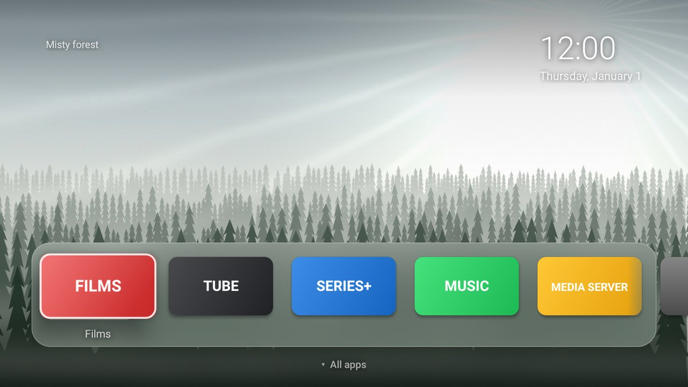
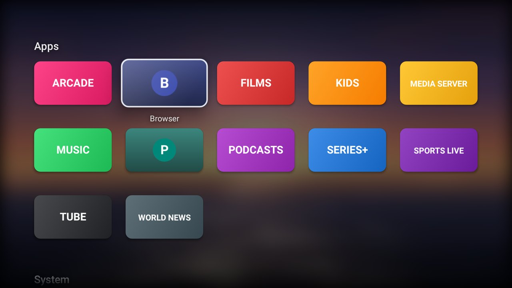
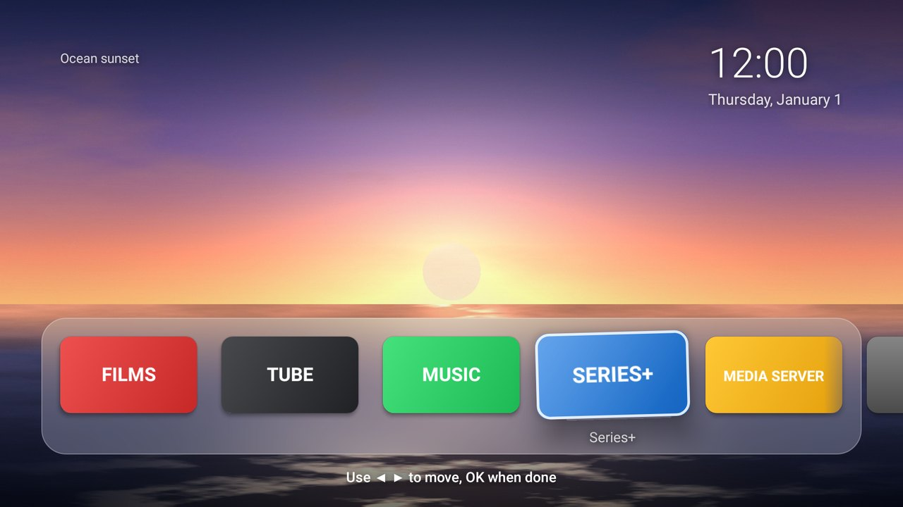

# Android TV makeover

Make a slow, ad-filled Android TV / Google TV fast and calm again. Every step is reversible.

1. **Find** the TV on your Wi-Fi and connect over ADB.
2. **Back up** every package's state, all settings and the home screen.
3. **Debloat**: turn off ads, ACR/telemetry and junk, and get asked about every app or feature you might
   use. Apps are disabled, never uninstalled.
4. **Re-home**: install TV Home, an Apple TV-style launcher with a glass dock of your favourite apps
   and rotating nature wallpapers.
5. **Check** each step with a screenshot from the TV (`report.html` collects them all).
6. **Restore** whenever you like with `restore.sh` / `restore.cmd`.



| All apps (press Down) | Rearranging the dock (hold OK) |
|---|---|
|  |  |

*(Previews are rendered from the launcher's real views with made-up apps; on your TV the tiles are your
apps' own banners, and the wallpapers are featured nature photos from Wikimedia Commons.)*

## You need

- A computer on the same network as the TV, with Python 3.8+ and `adb`
  (macOS `brew install android-platform-tools`, Windows `winget install Google.PlatformTools`,
  Linux `sudo apt install adb`).
- On the TV: **Settings > System > About** (Android TV: *Device Preferences > About*). Press OK on
  **Build** seven times, then in **Developer options** turn on **USB debugging** and **Network debugging**
  (or **Wireless debugging** on newer models).

## Run it

```bash
cd skills/android-tv-debloat
python3 scripts/tvctl.py discover
python3 scripts/tvctl.py connect <TV IP>      # press Allow on the TV
python3 scripts/tvctl.py backup
python3 scripts/tvctl.py debloat              # asks before anything you might use
python3 scripts/tvctl.py tweaks               # optional: faster animations, ad-blocking DNS
python3 scripts/tvctl.py home setup           # install TV Home, choose the dock, make it home
```

With Claude Code on that computer, just ask: *"debloat my Android TV and give it the TV Home launcher"*.
The skill in `SKILL.md` does the same steps, asks you in chat and reads every screenshot.

## Undo

```bash
sh tv-backups/<your-tv>-<date>/restore.sh          # macOS / Linux
tv-backups\<your-tv>-<date>\restore.cmd            # Windows
python3 scripts/tvctl.py restore                   # anywhere
```

Add `--keep-tv-home` to keep the launcher installed. If the TV's IP address changed, pass the new one
first: `sh restore.sh 192.168.1.50`.
